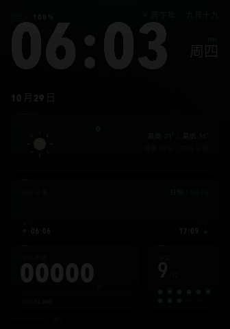

# 小米手环 10 Pro 表盘工具链（原生，无需手机 / 无需 Windows）

给小米手环 10 Pro（336 × 480 AMOLED，固件 3.101.043）做**深色数据仪表**风格表盘的
一套完整工具：纯 Python 的 `.face` 打包器、原生 SwiftUI 拖拽编辑器，以及一条
QEMU 模拟器调试回路——在 Mac 上改完表盘就能看真固件画出来的效果，不用连手机。

A complete toolchain for building Xiaomi Smart Band 10 Pro watch faces: a pure-Python
`.face` packer, a native SwiftUI drag editor, and a QEMU debug loop that renders your
face with the real firmware on Apple Silicon.



## 三层结构

| 目录 | 内容 | 说明 |
| --- | --- | --- |
| `native/` | `xwf_build.py` `xwf_face.py` `xwf_rle.py` `xwf_inspect.py` `xwf_probe.py` | 反编译 `.face` 容器格式后重写的打包核心。底图-only 与「底图 + 数字控件」输出都和官方 Compiler 4.23 **SHA-256 逐字节一致** |
| `macapp/` | `MiBandFaceStudio.swift` `build.sh` `Info.plist` | 原生 SwiftUI 壳：导入底图、拖拽控件、字号滑块、实时预览、一键出 `.face` |
| `emulator/` | `tools/` `patches/` | 把米坛的 QEMU 手环模拟器移植到 Apple Silicon 后，用来**真渲染**表盘的那套脚本与两处上游修复补丁 |

格式细节（容器头、栅格编码、控件表、元素记录）写在
[`native/FORMAT.md`](native/FORMAT.md)；36 个数据源的实测读数与判读写在
[`native/PROBE_RESULTS.md`](native/PROBE_RESULTS.md)。

## 快速开始

打包一个表盘（需要系统 Python 3 + Pillow：`pip3 install pillow`）：

```bash
cd native
/usr/bin/python3 xwf_build.py --help
```

模拟器里看真固件画出来的效果（需要先按 `emulator/README.md` 移植并编出
`qemu-system-arm`）：

```bash
cd vendor/miband-qemu            # DDlhy/Miband-qemu-simulator 的本地克隆
.venv/bin/python tools/face_render.py ../../miband10pro-face/native/design.face
```

SwiftUI 编辑器：

```bash
cd macapp && ./build.sh          # 产出 MiBandFaceStudio.app
```

## 装到真机

`native/design.face` 是可直接安装的成品。走米坛「表盘自定义工具」（安卓，v6.5.5+，
需要它从「小米运动健康」读到 AuthKey）导入 `.face` 后蓝牙推送；iOS 无法直推第三方表盘，
得借一台安卓机。安装时手环电量建议 ≥ 20%。

## 关键结论：为什么「数据不更新」

10 Pro 的元素数据记录有**两种写法**，只有一种会被数据源驱动：

- `0x03000000|图集序` → 固件把栅格当**静态图**画一次，之后永远不变；
- `0x07000000|控件序` → 指向控件表的一行，固件会**按绑定的数据源重绘**。

EasyFace 的 10 Pro 方言输出的是前者，所以排版全对、数字全死。本仓库的
`xwf_build.py` 默认输出后者（`XWF_WIDGET_ELEMENTS=0` 可切回），在模拟器里验证
时、分、秒、月、日、星期（中英）、电量全部为活值。

另注意 10 Pro **没有 DigitalNum 控件类型**：17 个原厂表盘的 465 个控件全是
kind 7（ImageList），`0x09` 只作为元素记录的类型字节出现。

## 现状

已动态：时、分、秒、月、日、星期（中英）、电量、天气温度。
仍静态：年、第几天、农历、日出日落、最高/最低、湿度/风、站立次数、天气图标。
天气图标（`3031`）与站立次数需要真机带手机验证；模拟器不产这些源，
宿主灌 `sensor-accel-*` / `sensor-pulse-bpm` 也推不动（详见 `emulator/README.md`）。

## 法律与边界

- 本仓库**不含任何小米固件镜像、`.face` 原厂素材或设备数据**；
  `emulator/patches/` 是针对 [DDlhy/Miband-qemu-simulator](https://github.com/DDlhy/Miband-qemu-simulator)
  的 diff，需自行克隆上游并 `git apply`。
- 上游模拟器与 BES 模型为 GPL；本仓库整体按 **GPL-2.0-or-later** 授权（`LICENSE` 为 v2 正文）。
- 格式逆向仅用于 interoperability，产物请在自己的设备上使用。

## 致谢 / 参考

- [DDlhy/Miband-qemu-simulator](https://github.com/DDlhy/Miband-qemu-simulator) — 米坛 29834 帖的 QEMU 手环模拟器
- [0x504B0304/bes-qemu](https://github.com/0x504B0304/bes-qemu) — BES SoC 模型基线
- 米坛「表盘自定义工具」/ EasyFace / Mi Create / Minstall — 见 [`design-assets.md`](design-assets.md) 的平台对比
