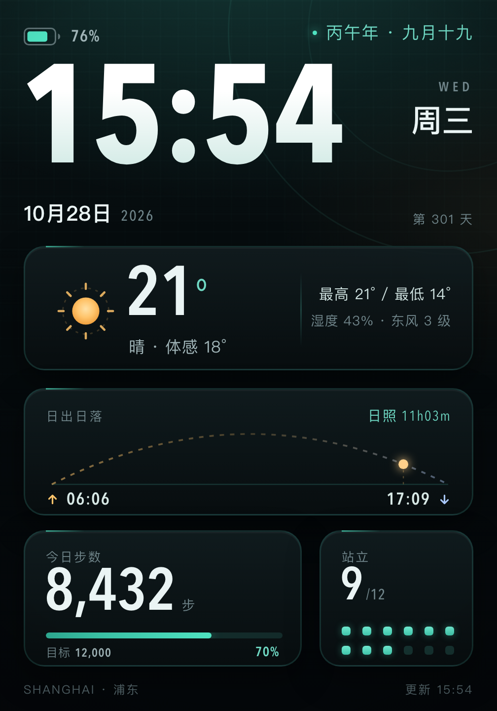

# 小米手环 10 Pro · 深色数据仪表表盘素材包



336 × 480（1x），3x 素材 1008 × 1440。数据快照：2026-10-28 15:54，上海浦东。

## 今日数据

| 项目 | 值 |
| --- | --- |
| 公历 | 2026 年 10 月 28 日，周三，第 301 天 |
| 农历 | 丙午年 九月十九（霜降后 5 天） |
| 天气 | 晴，21°C，体感 18°C |
| 高 / 低 | 21°C / 14°C |
| 湿度 / 风 | 43%，东风 3 级 |
| 日出 / 日落 | 06:06 / 17:09，日照 11h03m |
| 步数 / 目标 | 8,432 / 12,000（示例占位） |
| 站立 | 9 / 12（示例占位） |
| 电量 | 76%（示例占位） |

步数、站立、电量是设计稿占位值，真机由手环和表盘工具动态提供。

## 文件

- `preview@3x.png` / `preview.png`：完整效果图
- `background@3x.png` / `background.png`：表盘底图，动态项（时间、日期、星期、步数、电量、当前气温、天气文字）留空；农历、日出日落、最高最低、湿度风、站立已烘底
- `background-clean@3x.png` / `background-clean.png`：连静态数值也留空，适合全部自己摆
- `layout-guide@3x.png`：虚线框标出动态元素的建议位置
- `layout.json`：全部元素的坐标、字号、字重、颜色、对齐方式
- `assets/`：太阳图标、电池外壳、日出/日落箭头、太阳光点（SVG 源文件 + 3x 透明 PNG）
- `data.json`：本次数据快照与来源
- `face.html` + `render.sh`：改字后一键重出图

## 导入流程

1. 安卓手机安装米坛「表盘自定义工具」v6.5.5 或更新版本，按工具提示从「小米运动健康」读取 AuthKey。
2. 新建 336 × 480 表盘，导入 `background@3x.png`（想从零排就用 `background-clean@3x.png`）。
3. 对照 `layout-guide@3x.png` 和 `layout.json` 摆放动态元素：时间 94px、日期 14px、星期 21px、步数 40px、天气温度 47px、电量 11px。数字用 Avenir Next Condensed / DIN 一类窄体，中文用苹方。
4. 预览无误后导出 `.bin`，蓝牙推送到手环。安装时手环电量建议 ≥ 20%。
5. iOS 不能直推第三方表盘，需要借一台安卓手机。

## 能力边界（重要）

工具公开支持的动态元素是：时间、日期、步数、心率、电量、天气。因此：

- **农历、日出日落、站立次数**不是通用动态元素，已画进底图；它们会随日期过期，需要定期重生成或手动改。
- **天气**只有温度和天气文字能动态；最高最低、湿度、风向风力是静态文字，同样会过期。
- **步数进度条**在底图里留空，避免和真实步数对不上；`preview` 里的 70% 只是示意。
- 如果你的工具版本已经支持农历、站立或天气图标元素，优先用动态元素替换对应静态层，坐标照 `layout.json` 摆即可。
- 官方「相册表盘」只能换一张静态图，系统时间/数据的位置不可控，和本稿对不齐；只适合当备份方案。
- 第三方表盘依赖 AuthKey，小米运动健康升级后可能失效；安装前自行评估风险。

## 更新数据

直接改 `face.html` 里的文字（农历、日出日落、最高最低、湿度风、站立），然后运行：

```bash
./render.sh
```

农历可用香港天文台公历/农历对照表核对，天气和日出日落取自 wttr.in（上海）。

## 来源

- 屏幕规格：小米手环 10 Pro，1.74" AMOLED，480 × 336（竖屏 336 × 480）
- 农历：香港天文台 2026 年公历与农历日期对照表
- 天气 / 日出日落：wttr.in（2026-10-28 15:54 抓取）

## Windows / Linux / macOS 制作说明

- **Windows**：EasyFace 原生支持 10 Pro，最稳。用 `windows-easyface/` 里的底图、坐标和 `BUILD-WINDOWS.md` 构建。
- **Linux**：Mi Create 官方支持 Linux，编译时调用 Wine 跑 EasyFace 的 `compile.exe`；安装可用 Minstall 或米坛客户端。
- **macOS**：Mi Create 能编辑，但作者在代码里拦截了 macOS 编译（`macOS compiler support will be added soon`），需要 Windows/Linux 虚拟机。
- **网页版**：应用内有入口，但没有可靠的公开地址。

## Windows 构建包

`windows-easyface/` 包含 336×480 底图、图标、`layout.csv` 坐标表和完整的 EasyFace 构建步骤，直接看 `windows-easyface/BUILD-WINDOWS.md`。

## 原生 macOS 打包核心（native/）

`native/` 里是反编译 EasyFace `.face` 格式后写的纯 Python + Pillow 打包器，不依赖 Wine/CrossOver：

- 底图-only 与「底图 + 数字控件」输出都已和官方 Compiler 4.23 **SHA-256 逐字节一致**
- `native/design.face`：时间/步数/电量动态，日期/星期/农历/日出日落/站立静态烘底
- `native/design_mock.png`：合成预览
- `native/README.md`：格式摘要、用法、限制
- SwiftUI 编辑器是下一步（当前为 CLI）

## SwiftUI App（macapp/）

- `macapp/MiBandFaceStudio.app`：原生 SwiftUI 壳，已端到端验证
- 导入 336×480 底图/预览图、设置名称
- 拖动时间/步数/电量，字号滑块，实时预览，布局 JSON
- 动态时间/步数/电量/星期/天气温度/日期（月/日）；农历/日出日落/站立/天气图标静态
- 输出到 `~/Documents/MiBandFace/<名称>.face` 和 `-preview.png`
- 依赖系统 Python 3 + Pillow（`pip3 install pillow`）
- `macapp/build.sh` 可重新编译；当前是壳，拖拽编辑是下一步
